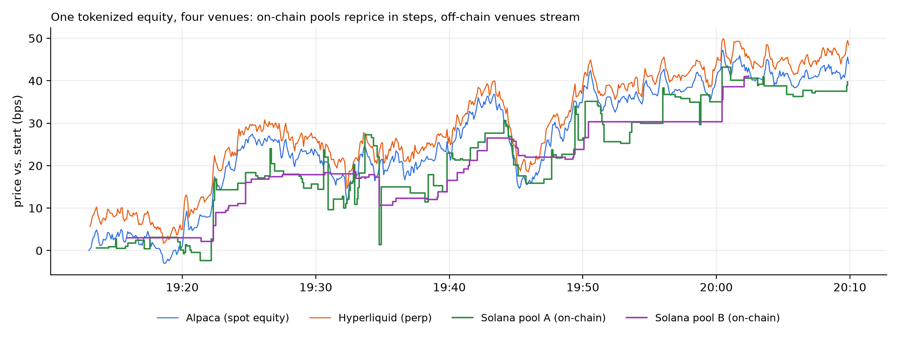
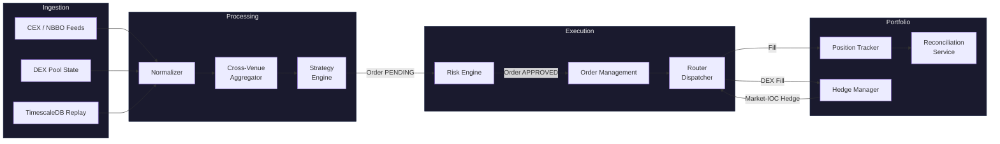
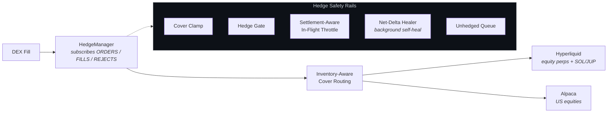
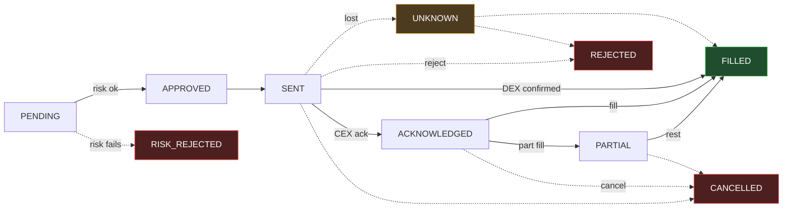
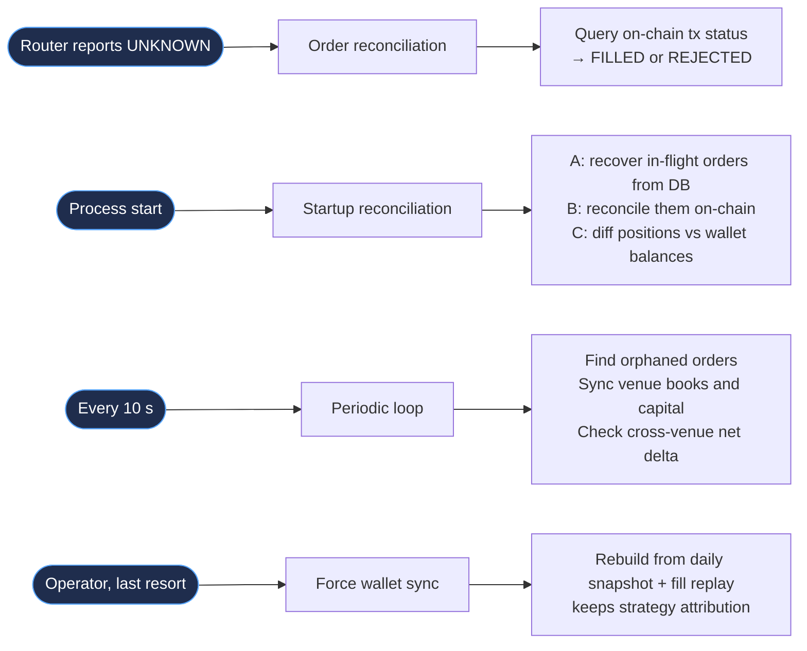
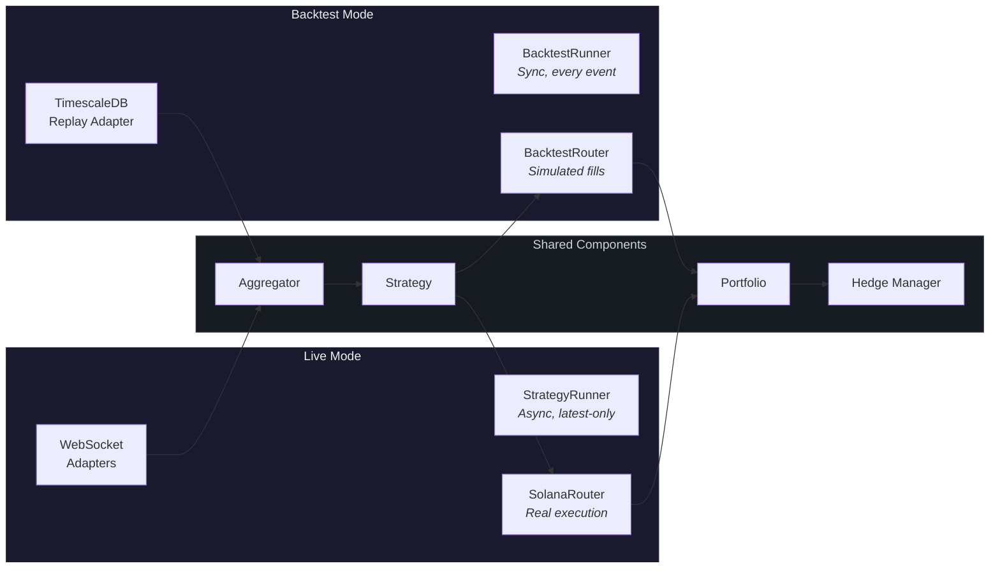
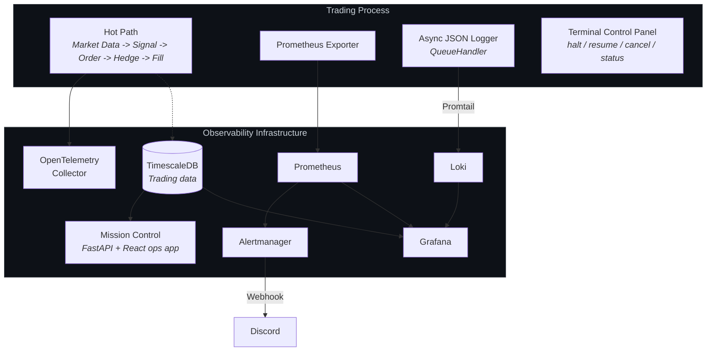

<h1 align="center">Event-Driven Trading System</h1>

  <strong>Hedged CEX–DEX spread capture on Solana tokenized equities: self-written decoders for 6 DEX protocols, every DEX fill hedged on Hyperliquid or Alpaca, one code path for backtest, replay and live. Built solo.</strong>

  
  

  
  
  
  
  
  
  

  <a href="#overview">Overview</a> · <a href="#highlights">Highlights</a> · <a href="#architecture">Architecture</a> · <a href="#tech-stack">Tech stack</a> · <a href="#testing">Testing</a>

---

> [!NOTE]
> This repository is an architecture overview. The implementation is private; questions are welcome at jannismenzler@gmail.com.
> The one exception is the C++ quote kernel in [`cpp/quote/`](cpp/quote/): it is self-contained, mirrors the public on-chain programs' math and backs the C++ claims below.

## Overview

Tokenized US equities (xStocks) trade in Solana AMM pools whose prices move only when someone trades on-chain, while price discovery for the same stocks is continuous on CEX and NBBO feeds. Fee-adjusted CEX fair value and the pool-implied price drift apart until the next on-chain trade closes the gap. The system takes the DEX leg when that gap clears an adaptive threshold and **immediately hedges it on a CEX or perp venue**, so it earns the basis instead of carrying directional inventory.

Latency matters, but it is bounded by Solana's block cadence: the system has to quote and act before the next block lands, not win a microsecond race. The harder engineering problem is getting *correct* prices, fills and hedges from six different AMM designs, and making backtest, replay and live agree on what a trade would have earned.

*One tokenized equity across four venues, plotted from the system's recorded market data (prices relative to the start). Pools reprice in discrete steps when someone trades against them; Alpaca and Hyperliquid stream continuously. The gaps between the lines are what the strategy trades.*

## Highlights

- **6 Solana DEX protocols** — Raydium V4/CLMM, Orca Whirlpool, Meteora DLMM, Byreal and Fusion CLMM, with self-written account decoders and swap builders, plus Jupiter multihop and flashloan routing.
- **Hedge by default** — every DEX fill produces a market-IOC cover on Hyperliquid perps or Alpaca equities, with a hedge gate, cover clamp and a background net-delta healer for partial fills and rejects.
- **Backtest = live code** — strategy, portfolio and hedge manager are the same objects in backtest, replay and live; only runner, router and risk-engine wrapper differ. The backtest is calibrated against live fills (hedge delay, slippage, Meteora's variable fees).
- **Exact on-chain quoting** — CLMM/DLMM quote math mirrors the on-chain programs; an optional C++20 backend (`QUOTE_BACKEND=cpp`, nanobind) is bit-identical to the Numba kernels and runs the CLMM trade-size search at a measured median of 37 µs vs 5.2 ms for the same code interpreted (Apple M3 Pro).
- **Crash-safe state** — capital reserved at order creation, idempotent orders and fills, 3-phase startup reconciliation against on-chain balances, circuit breakers and a kill switch.
- **Production observability** — per-stage latency passport, Prometheus, Loki, OpenTelemetry, Grafana and a FastAPI + React ops app, all off the hot path.

---

## Architecture

Each stage runs independently, talks over pub/sub events and stamps its work for end-to-end latency tracking. Every DEX fill is mirrored by the hedge manager onto a CEX/perp venue.

### Design decisions

| Decision | Why | Trade-off |
|---|---|---|
| **Protocols at every boundary** | Venues, routers and runners swap without touching strategy code | More interfaces to keep in sync |
| **Sync runner for backtest, async latest-only runner for live** | Backtest processes every event deterministically; live drops a stale signal when a newer event arrives | Two runners must be kept behaviourally equivalent — guarded by replay/live parity checks |
| **Hedge every DEX fill** | Profit is the captured basis, not inventory direction | Hedge fees and legging risk on every trade |
| **Capital reserved at PENDING, not at fill** | Concurrent orders can never jointly exceed limits | Capital sits idle while orders are in flight |
| **Decimal for all money, mypy + pyright strict** | Rounding and unit bugs show up at type-check time, not in P&L | Slower arithmetic outside the compiled kernels |
| **Market data persisted through a ring buffer to Redpanda → TimescaleDB** | The trading path never blocks on I/O | Persistence is eventually consistent |

### Strategy: hedged spread capture

The production strategy, `spread_capture_simplified`, is a taker on both legs:

- fee-adjusted divergence between each pool's implied price and CEX fair value;
- entry gated by an EWMA of recent basis volatility, not a fixed threshold;
- Meteora DLMM's variable fee read live from on-chain state into the synthetic spread;
- a mandatory hedge leg for every DEX fill.

An atomic DEX–DEX cross-pool arbitrage (`cross_pool_arb`) is implemented and also traded; older variants are kept for A/B comparison.

### Hedging and margin

- **Inventory-aware routing** picks the hedge venue per fill from current inventory across legs.
- **Cover clamp and hedge gate** put hard limits on hedge size and naked-exposure windows.
- **Net-delta healer** closes residual unhedged exposure left by partial fills and rejects.
- **Reg-T collateral model** (`CollateralAccount`) uses the same buying-power formula in live and backtest, so leverage behaviour is tested before it touches capital.

### Order lifecycle and risk gates

- **DEX orders are atomic** — a Solana transaction goes straight from `SENT` to `FILLED` or `REJECTED`; only CEX orders are acknowledged, fill partially or get cancelled (operator cancel-all, the hedge queue pulling a conflicting order, IOC tail, end-of-day expiry).
- **Fills are FIX-style** — the OMS trusts `leaves_qty` over a fill's declared type, so a mislabelled fill can't close an order early; the hedge manager keeps a hedge open through partials.
- **Nothing stays silent** — an ack-timeout watchdog asks the venue about quiet orders and resolves them to rejected, cancelled or `UNKNOWN`; reconciliation settles `UNKNOWN` against the chain or venue.

Every order passes five sequential checks that cannot be bypassed: prerequisites (not halted, data fresh), unreserved capital, per-symbol position limit, order size, and aggregate exposure. The router adds direction-correct average pricing and retry-with-reprice when an on-chain slippage guard reverts.

### Reconciliation

Portfolio state is checked against venues and the chain in four modes, from a single order up to a full rebuild:

### What fails, and what catches it

| Failure | Mechanism |
|---|---|
| Order outcome unknown after an RPC error or crash | `UNKNOWN` state + reconciliation queries on-chain state; a 10 s background loop finds orphaned orders |
| Process restarts mid-trade | 3-phase startup reconciliation: recover in-flight orders from the DB, reconcile them on-chain, then diff positions against wallet balances |
| Portfolio drifts from the wallet | Force wallet sync rebuilds from daily snapshots + fill replay, keeping strategy attribution |
| Duplicate submissions or fills | Idempotency on `client_order_id` and on fill `exec_id` |
| Out-of-order market data | Monotonic sequence tracking rejects late events; per-venue TTLs flag stale quotes |
| Repeated execution failures or drawdown | Circuit breakers set a global halt; a kill switch (TUI or API) blocks new orders at the risk engine |
| Solana transaction never lands | Blockhash expiry enforces a hard 60 s timeout |

### Backtest and live share one pipeline

The backtest is calibrated against live execution, not only replayed:

- **Hedge-leg delay and slippage** sampled from live fills (`cex_slip_calibration.csv`).
- **Meteora DLMM variable fees** rebuilt historically, so backtest fees match what each pool actually charged.
- **One market calendar** for trading hours in both modes.
- **Fill confirmation window** — a simulated fill executes only if price moves through the order level within a configurable window.
- **Purged walk-forward validation** for parameter sweeps (`backtesting/sweep/walk_forward.py`).

Risk checks run in a synchronous engine for backtest and an async one for live; both implement the same `RiskEngine` protocol.

### Observability

Every stage stamps a `TimestampPassport`, so latency is visible per stage (P50/P75/P99/P99.9) without touching the hot path; metrics, logs and traces ship asynchronously.

Alerts watch what actually breaks a hedged book, not just CPU and uptime:

| Alert family | Examples |
|---|---|
| Data freshness | stale Hyperliquid, Alpaca, IBKR or DEX pool data for an active symbol; Helius collector degraded |
| Hedge integrity | sustained cross-venue net-delta breach, hedge on the wrong venue, split hedges persisting |
| Position book | book invariant violated, unexplained positions aging in suspense |
| Execution | OMS ack-timeout bursts, fill latency, RPC error rate |
| System | halt engaged, WebSocket or IB Gateway disconnected, dropped market-event rows |

Grafana covers portfolio, cross-venue spreads, order lifecycle with hedge TCA, per-stage latency and log search; **Mission Control** (`obs-app`) adds an operations view with fill markers and live position state.

### Venues

| Venue | Role |
|---|---|
| Raydium V4 / CLMM, Orca Whirlpool, Meteora DLMM, Byreal CLMM, Fusion CLMM | Trade-capable DEX pools (constant-product, tick and bin liquidity) |
| Jupiter | Multihop and flashloan routing |
| Hyperliquid | Primary perp hedge venue (xStock equity perps, SOL/JUP) |
| Alpaca | US-equity trading and hedge leg |
| IBKR (IB Gateway) | NBBO equity feed, read-only |
| Helius | Pool-state WebSockets and Sender API transaction submission |

### Tech stack

| Layer | Technology | Why |
|---|---|---|
| Language and types | Python 3.14, mypy `--strict`, pyright strict | Fast iteration with type-checked boundaries; `Protocol`-based dependency injection |
| Compute | Numba, optional C++20 via nanobind, Polars | Compiled quote kernels and size search; columnar replay for sweeps |
| Storage | TimescaleDB (PostgreSQL 16) | Market data, orders, fills and latency as compressed hypertables |
| Streaming | Redpanda (Kafka API) | Persists market events off the hot path |
| Chain access | Helius WebSockets + Sender API | Pool-state subscriptions and transaction landing |
| Observability | Prometheus, OpenTelemetry, Loki + Promtail, Grafana, Alertmanager | Metrics, traces and logs in one place, alerts to Discord |
| Ops app | FastAPI + React | Mission Control panel |
| Deployment | Docker Compose with profiles, uv | Full stack in one command; trading only starts deliberately |

---

## Testing

| Suite | Covers |
|---|---|
| `unit`, `integration` | Component behaviour and interaction, with shared factories instead of hand-built objects |
| `specification`, `property` | System invariants (cash conservation, trade-direction integrity, financial precision) plus Hypothesis properties of the backtester |
| `stress`, `acceptance` | Throughput storms and capacity ramps |
| `user_story` | End-to-end trading flows |
| `external` | Opt-in contract tests against real venue APIs |

CI runs ruff, `mypy --strict` and pytest on every push and pull request. Replay/live parity and C++/Numba bit-exactness are tested, not assumed.
